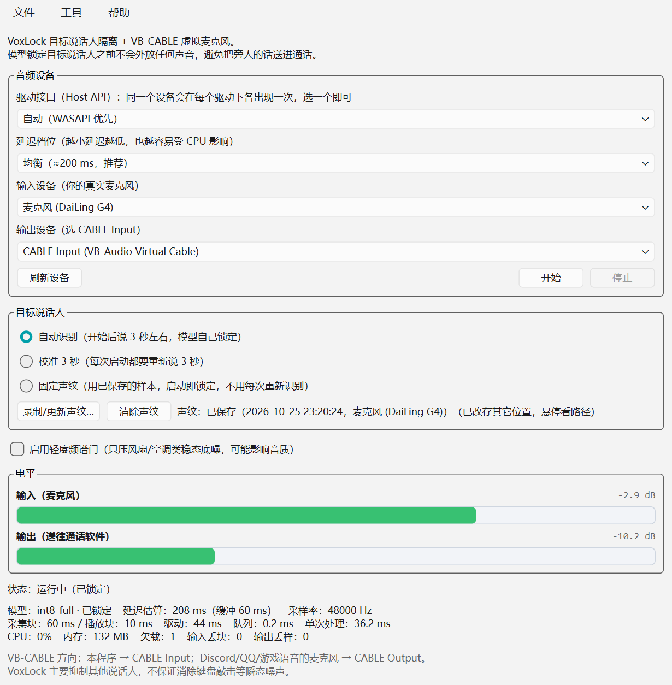

# VoxCall · Beta 0.01

[](https://github.com/HHEENNGG/VoxCall/actions/workflows/tests.yml)
[](https://github.com/HHEENNGG/VoxCall/releases)
[](LICENSE)
[](https://github.com/HHEENNGG/VoxCall)



VoxCall 是一款 Windows 实时通话降噪工具：用 **VoxLock** 做目标说话人隔离，只保留你的声音，
再通过 **VB-CABLE** 把处理后的音频送进 Discord、QQ、游戏语音等任意通话软件。

## 能做什么

- **只留你**：抑制房间里其他人的说话声，而不是简单地把所有声音一起压低
- **不泄露**：模型锁定你之前，输出是静音——不会把旁人的话直接送进通话
- **录一次，长期用**：固定声纹模式，启动即锁定，不用每次重新识别
- **底噪兜底**：可选的轻度频谱门，压低风扇、空调、电流声
- **设备列表干净**：按驱动接口过滤，默认只列 WASAPI 设备
- **实时指标**：延迟、缓冲、欠载、电平一眼可见，便于判断卡顿原因
- **自动检查更新**：启动后静默查询 GitHub Releases，有新版本会提示并可一键打开下载页
  （可在配置里关闭；也可以手动「帮助 → 检查更新…」）

## 系统要求

- Windows 10 / 11（64 位）
- [VB-CABLE](https://vb-audio.com/Cable/) 虚拟声卡——安装包已内置（官方原版，未修改），
  没装时点一下就能装，**离线也可以**
- 独立版开箱即用，不需要安装 Python；源码版需要 Python 3.11–3.13

## 开始使用

1. 双击 `VoxCall.exe` 启动（无控制台窗口）
2. 如果没检测到 VB-CABLE，程序会提示并可**一键安装**（使用内置的官方安装包；
   需要管理员权限；装完会问你要不要立即重启）
3. 驱动接口选 **自动（WASAPI 优先）**；输入选你的麦克风，输出选 **CABLE Input**
4. 选择锁定方式，点「开始」
5. 在通话软件里把麦克风设为 **CABLE Output**

### 托盘与后台运行

点窗口右上角的关闭按钮**不会退出**，而是收起到右下角托盘，降噪继续在后台跑——适合一边通话一边
开游戏或全屏应用。托盘图标右键菜单可以：

- 显示主窗口 / 开始或停止降噪
- 检查更新、打开设置
- 退出 VoxCall（真正结束进程）

不想用托盘的话在「文件 → 设置…」里关掉「点关闭时最小化到托盘」即可。

### 菜单说明

| 菜单 | 内容 |
| --- | --- |
| 文件 | 设置…（Ctrl+,）、退出（Ctrl+Q） |
| 工具 | 检查更新…、安装 VB-CABLE…、打开配置文件夹、打开日志文件夹 |
| 帮助 | 关于 VoxCall（版本、作者、运行环境） |

```
VoxCall ──输出──> CABLE Input ──(虚拟线)──> CABLE Output ──输入──> 通话软件
```

## 三种锁定方式

| 模式 | 什么时候锁定 | 适合 |
| --- | --- | --- |
| 自动识别 | 开始后说满约 3 秒语音 | 随手用；环境安静 |
| 校准 3 秒 | 每次开始后录 3 秒 | 环境吵、想锁定更准；但每次都要说 |
| **固定声纹** | 模型加载完立刻锁定，不用再说话 | 长期自己用：录一次，以后一键启动 |

固定声纹：点「录制/更新声纹…」，对着麦克风连续说 3 秒即可。样本只存在本机，可随时「清除声纹」。

## 关于延迟

界面上的「延迟估算」由几段组成：驱动缓冲 + 采集块 + 队列 + 播放缓冲 + 模型算法延迟（24 ms）。
默认「均衡」档在本机实测约 200 ms；「低延迟」档约 180–210 ms 但更依赖 CPU；「稳定」档约 240 ms。
如果「欠载」持续增长，说明 CPU 跟不上，往「稳定」调一档即可。

## 界面上的数字

- **电平条**：左侧输入、右侧输出，右侧同时显示峰值 dB；接近 0 dB 变红并标「过载」
- **监控行**：CPU（占整机百分比）、内存（进程工作集）、驱动/队列/单次处理耗时、欠载与丢块计数
- 所有设置（锁定方式、设备、驱动接口、延迟档位、频谱门）**改完立即保存**，下次启动原样恢复

## 配置

配置文件 `config.toml` 与程序放在同一目录，常用项：

| 键 | 说明 |
| --- | --- |
| `audio.hostapi` | `auto`（只列 WASAPI）/ `all`（所有驱动）/ 具体接口名 |
| `audio.chunk_ms` | 采集块长度，默认 60 ms；也可直接用界面「延迟档位」 |
| `audio.target_latency_ms` | 播放缓冲目标，越小延迟越低、越容易欠载 |
| `model.mode` | `auto` / `calibrated` / `fixed` / `off`（只做路由） |
| `model.precision` | `int8-full`（默认，最快）/ `int8` / `fp16` / `fp32` |
| `denoise.enabled` | 轻度频谱门开关（也可在界面勾选，实时生效） |
| `app.check_updates` | 启动时自动检查更新，默认 `true`；设成 `false` 完全关闭联网检查 |
| `app.update_check_hours` | 自动检查的缓存时长，默认 12 小时（不会每次启动都请求） |
| `app.close_to_tray` | 点关闭时收起到托盘，默认 `true`；设 `false` 则点关闭直接退出 |
| `app.start_minimized` | 启动后直接最小化到托盘，默认 `false` |

## 已知限制

- VoxLock 是**目标说话人隔离**，不是通用降噪；键盘、关门这类瞬态噪声它不管
- 频谱门只压稳态底噪，强度过大可能有「水声」伪影
- 暂不支持回声消除（AEC）、设备热插拔、自动增益
- 程序未签名，首次在其他电脑运行可能被 SmartScreen 提示「更多信息 → 仍要运行」

## 许可与致谢

本项目代码采用 MIT 许可。VoxLock 模型为 Apache-2.0。

VB-CABLE 由 [VB-Audio Software](https://vb-audio.com/)（Vincent Burel）开发，是
**donationware**：免费使用，觉得有用欢迎[捐赠/购买许可](https://shop.vb-audio.com/en/win-apps/11-vb-cable.html)。
安装包随本程序分发（官方原版，未做任何修改，来源 [vb-cable.com](https://www.vb-cable.com)），
仅在系统未安装时解压并运行官方安装程序。其余第三方组件见 `NOTICE.md`。

## 从源码运行

```powershell
git clone <this-repo> VoxCall
cd VoxCall
.\install.ps1 -Portable     # 下载便携 Python 3.13 并装依赖（约 200 MB）
.\run.bat                   # 启动（无控制台窗口）
.\selftest.bat              # 跑单元测试
```

首次启动会从 Hugging Face 下载约 75 MB 模型；国内网络可先设置
`$env:HF_ENDPOINT = "https://hf-mirror.com"`。也可以把 `models\onnx` 目录直接放进项目根目录，
程序会优先使用本地模型。

打包独立 exe：`.\build_exe.ps1`（或 `-Zip` 顺带压缩），产物在 `_dist\VoxCall\`。

## 目录结构

```
main.py              入口（--doctor 环境自检 / --simulate 离线仿真）
app/                 音频管线、模型适配、设备枚举、声纹、频谱门、VB-CABLE 安装
tests/               单元测试（假声卡与假模型，无需真实硬件）
assets/              图标；vbcable/ 内置官方 VB-CABLE 安装包
docs/screenshot.png  界面截图
install.ps1          安装（便携运行时或虚拟环境）
build_exe.ps1        打包 PyInstaller onedir
```

---

版本 **Beta 0.01** · 作者 **老鼠秋日私语**
由 AI 辅助编写
